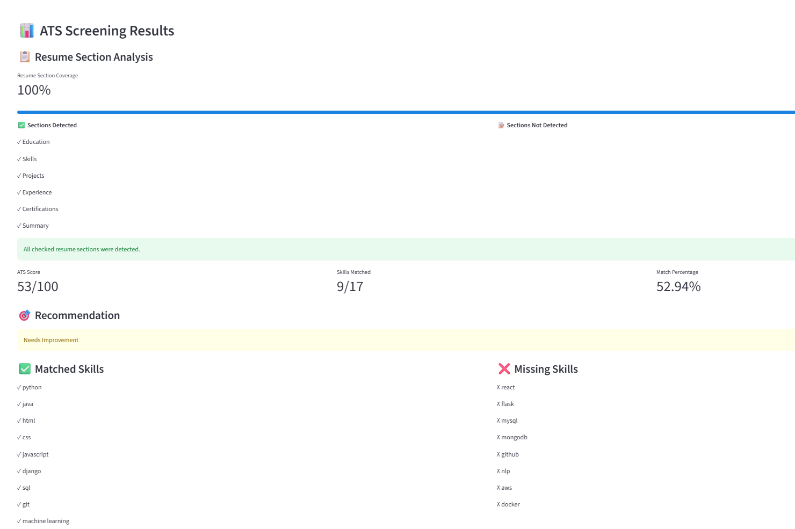
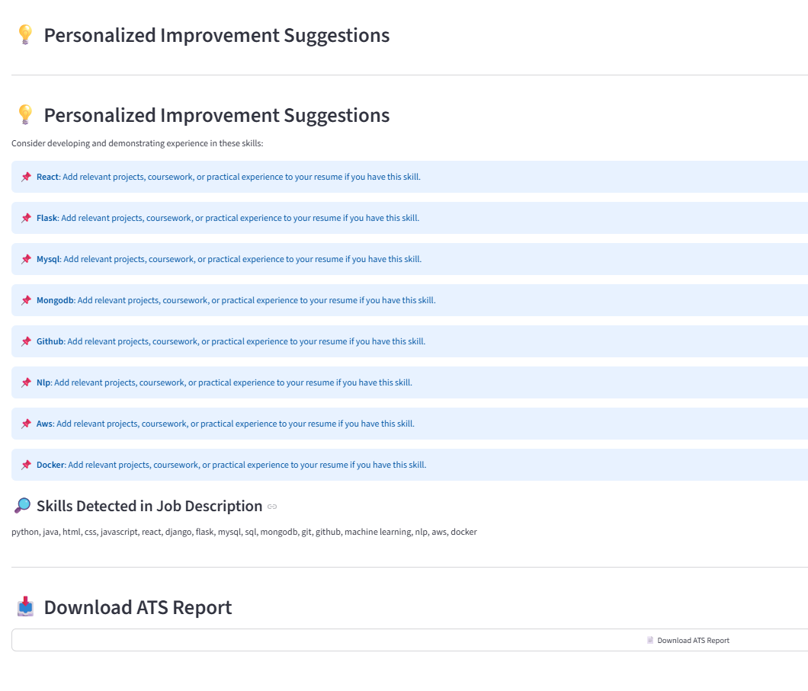

# 📄 AI Resume Screening & ATS Analyzer

An interactive, Python-based resume screening application that analyzes PDF resumes against job descriptions, identifies matching and missing skills, calculates a skill-match score, and provides improvement suggestions.

## 🚀 Features

* 📄 **PDF Resume Upload:** Upload and extract text from PDF resumes.
* 📝 **Job Description Matching:** Compare resume content with job requirements.
* ✅ **Skill Matching:** Identify matched and missing technical skills.
* 📊 **ATS Score:** Calculate a skill-match percentage and display a recommendation.
* 💡 **Skill Gap Analysis:** Provide suggestions based on missing skills.
* 📋 **Resume Section Analysis:** Check for Education, Skills, Projects, Experience, Certifications and Summary.
* 📥 **PDF Report:** Download screening results as a PDF.
* 🌐 **Interactive Dashboard:** User-friendly interface built with Streamlit.

## 🛠️ Technologies Used

* Python
* Streamlit
* PyPDF2
* ReportLab
* Regular Expressions

## 📂 Project Structure

```text
AI_Resume_Screener/
├── app.py
├── resume_screener.py
├── pdf_test.py
├── test_resume.pdf
├── requirements.txt
└── README.md
```

## ⚙️ Installation

1. Clone the repository:

   ```bash
   git clone YOUR_GITHUB_REPOSITORY_URL
   ```

2. Navigate to the project folder:

   ```bash
   cd AI_Resume_Screener
   ```

3. Install dependencies:

   ```bash
   python -m pip install -r requirements.txt
   ```

4. Run the application:

   ```bash
   python -m streamlit run app.py
   ```

5. Open the local URL displayed in the terminal.

## 🧠 How It Works

1. The user uploads a PDF resume.
2. The application extracts text from the PDF.
3. The user enters a job description.
4. The system detects recognized skills in the job description.
5. It compares those skills with the extracted resume text.
6. It calculates a skill-match score and identifies missing skills.
7. It checks for key resume sections and generates suggestions.
8. The user can download a PDF report.

## 📌 Future Enhancements

* NLP-based semantic skill matching.
* More detailed resume formatting and keyword analysis.
* Expanded technical skill database.
* Improved recommendations based on job roles.

## ⚠️ Disclaimer

The ATS score is a rule-based skill-match estimate for guidance only. It does not represent the actual score or decision of any employer's Applicant Tracking System.

## 👩‍💻 Author

Laasya Garaga
B.Tech – Information Technology

## 📸 Application Screenshots

### ATS Screening Results



### PDF Screening Report


